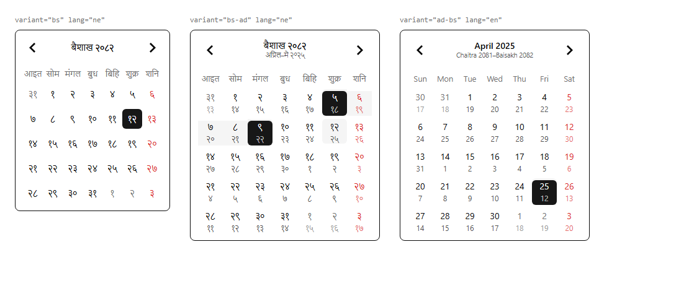

# nepali-day-picker

Bikram Sambat (BS, विक्रम संवत्) ↔ Gregorian (AD) date conversion, formatting, parsing, Nepal
fiscal-year helpers and public holidays for JavaScript and TypeScript, a calendar grid for any
framework, and a BS calendar for react-day-picker and shadcn/ui.

- **Accurate:** a month-length table for BS 1970–2100, cross-checked against five other packages, with
  a round-trip test over every one of its ~47,800 days. Years the calendar committee has not
  published yet (BS 2084 on) throw a `ProjectedDateError` instead of returning a guess.
- **Plain `Date` values:** you store, send and validate ordinary JavaScript `Date`s; BS is only how
  they are read and written.
- **Nepali and English:** Devanagari or ASCII digits and names, everyday or formal month spellings.
- **Small and dependency-free:** about 5.9 kB minified and brotli-compressed for the whole core,
  1.4 kB for just `adToBs` and `bsToAd`, and 7.9 kB for the calendar on top of react-day-picker,
  holiday data included. The core never loads React or the holiday data, and the other entries share
  its code instead of copying it, in both the ESM and the CommonJS build. TypeScript types.
  Tree-shakeable.
- **Time-zone safe:** tested in seven time zones, including Asia/Kathmandu (UTC+5:45).

- **Any framework:** the core has no dependencies, and `getBsMonthGrid` gives a BS month as plain data
  to render in Vue, Svelte, Angular or plain DOM.
- **A calendar for react-day-picker and shadcn/ui:** BS months in the calendar you already use, with
  four display modes, in `nepali-day-picker/react`.
- **Holidays and events:** Nepal's nationwide public holidays in red, from
  [`data/holidays.json`](https://github.com/sandeshthapa07/nepali-day-picker/blob/main/data/holidays.json)
  (BS 2083 for now), and your own holidays and events, any number at once, in the same JSON format.
  See [Holidays and events](https://github.com/sandeshthapa07/nepali-day-picker/blob/main/docs/react.md#holidays-and-events).



## Install

```sh
npm install nepali-day-picker
```

## Quick start

```ts
import { adToBs, bsToAd, formatBs, parseBs, getFiscalYear, formatFiscalYear } from "nepali-day-picker";

adToBs(new Date(2025, 3, 25)); // { year: 2082, month: 1, day: 12 }
bsToAd(2082, 1, 12); // Date: Fri 25 Apr 2025, local midnight

formatBs(new Date(2025, 3, 25), "full"); // "शुक्रबार, १२ बैशाख २०८२"
formatBs(new Date(2025, 3, 25), "D MMMM YYYY", { lang: "en" }); // "12 Baisakh 2082"
formatBs(new Date(2025, 3, 25), "DD/MM/YYYY", { lang: "ne", digits: "en" }); // "12/01/2082"

parseBs("१२ बैशाख २०८२", "D MMMM YYYY"); // Date: 25 Apr 2025
parseBs("12/01/2082", ["YYYY-MM-DD", "DD/MM/YYYY"]); // tries each pattern in order

getFiscalYear(new Date(2025, 6, 17)); // 2082, i.e. FY 2082/83
formatFiscalYear(2082, { prefix: true }); // "आ.व. २०८२/८३"
```

## Calendar (React)

```sh
npm install nepali-day-picker react-day-picker
```

```tsx
import { DayPicker } from "nepali-day-picker/react";
import "react-day-picker/style.css";

<DayPicker mode="single" selected={date} onSelect={setDate} variant="bs-ad" lang="ne" />;
```

`variant` is `"bs"` (default), `"bs-ad"`, `"ad-bs"` or `"ad"`. The selected value is a plain `Date`.

**Holidays and events:** Nepal's nationwide public holidays and Saturdays show in red with no setup.
Add your own holidays and events in bulk, in the format of [`data/holidays.json`](https://github.com/sandeshthapa07/nepali-day-picker/blob/main/data/holidays.json):

```tsx
const events = [
  { date: "2083-08-15", name: "Office party" }, // a dot under the day
  { date: "2083-09-01", name: "Company holiday", type: "holiday" }, // red, like a public holiday
  { date: "2055-02-05", name: "Sita's birthday", repeat: "yearly" }, // every year on 5 Jestha
];
<DayPicker mode="single" selected={date} onSelect={setDate} events={events} />;
```

Read JSON from a file or an API with `parseEvents(json)`, which checks every entry. Turn the built-in
list off with `holidays={false}`.

**shadcn/ui:** in `components/ui/calendar.tsx`, import from `nepali-day-picker/react` instead of
`react-day-picker` and delete the default `formatMonthDropdown`. Your `<Calendar />` then takes the same
props. To avoid editing the file, spread `useNepaliCalendar({ DayButton: CalendarDayButton })` into it.
See the [calendar guide](https://github.com/sandeshthapa07/nepali-day-picker/blob/main/docs/react.md).

## Documentation

- [Getting started](https://github.com/sandeshthapa07/nepali-day-picker/blob/main/docs/getting-started.md): install, convert, format and parse in five minutes
- [Calendar for react-day-picker and shadcn/ui](https://github.com/sandeshthapa07/nepali-day-picker/blob/main/docs/react.md): variants, props, shadcn setup, holidays and events, future dates, a date picker
- [Guides and recipes](https://github.com/sandeshthapa07/nepali-day-picker/blob/main/docs/guides.md): forms, Zod, databases and APIs, servers in UTC, fiscal-year reports, future dates, a BS month grid for Vue, Svelte or plain DOM
- [API reference](https://github.com/sandeshthapa07/nepali-day-picker/blob/main/docs/api.md): every function, option and token
- [Why nepali-day-picker](https://github.com/sandeshthapa07/nepali-day-picker/blob/main/docs/why.md): benefits, data accuracy, limits and FAQ
- [Contributing](https://github.com/sandeshthapa07/nepali-day-picker/blob/main/CONTRIBUTING.md): report a wrong date, set up, release

## Basics

- BS months are numbered 1–12, Baisakh = 1.
- A `Date` stands for its **local calendar day**; the time of day is ignored. `bsToAd` returns local
  midnight.
- Supported range: **BS 1970-01-01 to BS 2083-12-30** (AD 1913-04-13 to AD 2027-04-13), the years
  with published month lengths. Outside it, `adToBs`, `bsToAd` and `formatBs` throw a `RangeError`
  that names the range. `parseBs` returns `null` and never throws.
- **Future years are not fixed yet.** Nepal's calendar committee has not published BS 2084 onward, so
  a date there throws a `ProjectedDateError` (a `RangeError`). If an estimate that can be a day off
  is acceptable, call `allowProjectedDates()` once at startup to open the table's projections up to
  BS 2100 (AD 2044-04-13). See [Projected years](#projected-years).
- `lang` defaults to `"ne"` (Devanagari names and digits). Pass `{ lang: "en" }` for English.

## API

### Conversion

| Function                                                     | Returns                                                                                |
| ------------------------------------------------------------ | -------------------------------------------------------------------------------------- |
| `adToBs(date)`                                               | `{ year, month, day }`                                                                 |
| `bsToAd(year, month, day)` or `bsToAd({ year, month, day })` | `Date` at local midnight                                                               |
| `getBsMonthLength(year, month)`                              | Days in the month, 29–32                                                               |
| `isValidBs(year, month, day)`                                | `true` if the date exists and is in range                                              |
| `BS_RANGE`                                                   | `start` and `end` as BS dates; `startDate` and `endDate` as new `Date`s on each read   |
| `BS_DATA_INFO`                                               | Which years are projected, disputed or single-source ([Data accuracy](#data-accuracy)) |
| `allowProjectedDates(allow?)`                                | Accept dates in projected years (BS 2084–2100); `false` turns the check back on        |
| `ProjectedDateError`                                         | The error thrown for a projected date; has `year`, extends `RangeError`                |

### Formatting

| Function                                              | Returns                                                           |
| ----------------------------------------------------- | ----------------------------------------------------------------- |
| `formatBs(date, pattern, options?)`                   | The date as BS text                                               |
| `formatAd(date, pattern, options?)`                   | The date as Gregorian text, same tokens and options               |
| `createFormatter({ pattern, calendar?, ...options })` | A reusable `(date) => string`, compiled once for lists and tables |

Options: `lang: "ne" | "en"` (names and default digits), `digits: "ne" | "en"` (digits only), and
`monthNames: "common" | "formal"` (बैशाख or वैशाख).

**Tokens** are case-sensitive and follow Day.js. Examples use 12 Baisakh 2082 (Friday 25 April 2025).

| Token                 | Meaning                             | `ne`             | `en`              |
| --------------------- | ----------------------------------- | ---------------- | ----------------- |
| `YYYY`                | Year                                | २०८२             | 2082              |
| `YY`                  | 2-digit year                        | ८२               | 82                |
| `M` / `MM`            | Month number                        | १ / ०१           | 1 / 01            |
| `MMM`                 | Short month name                    | बैशाख             | Bai               |
| `MMMM`                | Month name                          | बैशाख             | Baisakh           |
| `D` / `DD`            | Day of month                        | १२ / १२          | 12 / 12           |
| `Do`                  | Day with suffix                     | १२ गते            | 12th              |
| `d`                   | Weekday number, 0 = Sunday          | ५                | 5                 |
| `dd` / `ddd` / `dddd` | Weekday name, narrow / short / full | शु / शुक्र / शुक्रबार | Fr / Fri / Friday |
| `w` / `ww`            | Week of the year                    | २ / ०२           | 2 / 02            |
| `[text]`              | Printed as written                  | `[गते]` → गते      | `[of]` → of       |

Any other character (`/`, `-`, `.`, `,`, spaces) prints as written. Use brackets around words, since
letters such as `D` and `d` are tokens.

**Presets** can be passed in place of a pattern:

| Preset     | Pattern                           | `ne`                 | `en`                    |
| ---------- | --------------------------------- | -------------------- | ----------------------- |
| `"short"`  | `DD/MM/YYYY`                      | १२/०१/२०८२           | 12/01/2082              |
| `"medium"` | `D MMM YYYY`                      | १२ बैशाख २०८२         | 12 Bai 2082             |
| `"long"`   | `D MMMM YYYY`                     | १२ बैशाख २०८२         | 12 Baisakh 2082         |
| `"full"`   | `dddd, D MMMM YYYY`               | शुक्रबार, १२ बैशाख २०८२ | Friday, 12 Baisakh 2082 |
| `"iso"`    | `YYYY-MM-DD`, always ASCII digits | 2082-01-12           | 2082-01-12              |

Use `"iso"` for storage, URLs and sorting, because it never changes with `lang`.

### Parsing

| Function                                     | Returns                             |
| -------------------------------------------- | ----------------------------------- |
| `parseBs(text, pattern, { referenceDate? })` | `Date` at local midnight, or `null` |
| `parseAd(text, pattern, { referenceDate? })` | `Date` at local midnight, or `null` |

- `pattern` is a pattern, a preset, or a list of them tried in order.
- Digits may be Nepali, ASCII or mixed.
- Month names match in any case and in common spellings: Baishakh, Vaisakh, Saun, Marga, वैशाख and
  others.
- `YY` resolves to the year nearest `referenceDate` (default: today), so `82` becomes 2082.
- A date that does not exist, such as day 32 of a 31-day month, returns `null`.

### Fiscal year

Nepal's fiscal year (आर्थिक वर्ष) runs from Shrawan 1 to the last day of Asar; FY 2082/83 runs from
17 July 2025 to 16 July 2026. A fiscal year is named by the BS year it starts in (`2082`).

| Function                                                      | Returns                                                                |
| ------------------------------------------------------------- | ---------------------------------------------------------------------- |
| `getFiscalYear(date, options?)`                               | The fiscal year, for example `2082`                                    |
| `getFiscalPeriod(date, period?, options?)`                    | `{ fiscalYear, index, start, end }` for the period that holds the date |
| `getFiscalPeriodRange(fiscalYear, period?, index?, options?)` | `{ start, end }`, the first and last day as `Date`s                    |
| `formatFiscalYear(fiscalYear, options?)`                      | `"२०८२/८३"`, `"2082/083"`, `"FY 2082/83"` …                            |
| `parseFiscalYear(text, options?)`                             | `2082`, or `null`                                                      |

```ts
getFiscalPeriod(new Date(2026, 10, 24), "trimester");
// { fiscalYear: 2083, index: 2, start: 17 Nov 2026, end: 14 Mar 2027 }

getFiscalPeriodRange(2082, "quarter", 4); // first and last day of Baisakh–Asar 2083
parseFiscalYear("आ.व. २०८२/०८३"); // 2082
```

| `period`                | Months | Periods in a Shrawan-start year                          |
| ----------------------- | ------ | -------------------------------------------------------- |
| `"year"` (default)      | 12     | Shrawan–Asar                                             |
| `"half"` (अर्धवार्षिक)    | 6      | Shrawan–Poush, Magh–Asar                                 |
| `"trimester"` (चौमासिक) | 4      | Shrawan–Kartik, Mangsir–Falgun, Chaitra–Asar             |
| `"quarter"` (त्रैमासिक)   | 3      | Shrawan–Ashwin, Kartik–Poush, Magh–Chaitra, Baisakh–Asar |
| `"month"`               | 1      | Shrawan (1) to Asar (12)                                 |

`formatFiscalYear` options: `lang`, `digits`, `style` (`"short"` 2082/83, `"padded"` 2082/083,
`"full"` 2082/2083) and `prefix` (adds आ.व. or FY).

**Other fiscal years:** every fiscal function takes `{ startMonth }` (BS month 1–12, default 4 for
Shrawan). For example, `{ startMonth: 1 }` gives a year that starts on Baisakh 1, such as many school
years.

### Weeks, names and digits

| Export                                         | What it is                                                                       |
| ---------------------------------------------- | -------------------------------------------------------------------------------- |
| `getBsWeek(date)`                              | Week of the BS year, 1–53. Weeks run Sunday to Saturday; week 1 holds Baisakh 1. |
| `getBsWeekOfMonth(date)`                       | Row 1–6 of the date in its BS month grid                                         |
| `getAdWeek(date)`                              | Week of the Gregorian year, same rule                                            |
| `BS_MONTHS`, `AD_MONTHS`, `WEEKDAYS`           | Name tables: `ne` and `en`, with `long`, `short` (and `narrow`, `formal`) lists  |
| `toNepaliDigits(value)`, `toAsciiDigits(text)` | Converts between ०–९ and 0–9                                                     |
| `FORMAT_PRESETS`                               | The preset patterns                                                              |

### Calendar grid, for any framework

`getBsMonthGrid(year, month, options?)` returns a BS month as plain data: weeks of days, each with its
`Date`, BS and AD dates, and `outside`, `today`, `saturday`, `holiday` and `events` flags, plus links
to the previous and next month. Render it in Vue, Svelte, Angular or plain DOM; see
[Build a BS month grid](https://github.com/sandeshthapa07/nepali-day-picker/blob/main/docs/guides.md#build-a-bs-month-grid).

```ts
const grid = getBsMonthGrid(2083, 8, { events: createEventLookup(NEPAL_HOLIDAYS) });
grid.weeks.map((week) => week.map((day) => (day.outside ? "" : day.bs.day)));
```

### Holidays and events (`nepali-day-picker/holidays`)

A separate entry: the core never loads the holiday data.

| Export                      | What it is                                                                                                                               |
| --------------------------- | ---------------------------------------------------------------------------------------------------------------------------------------- |
| `NEPAL_HOLIDAYS`            | Nationwide public holidays from [`data/holidays.json`](https://github.com/sandeshthapa07/nepali-day-picker/blob/main/data/holidays.json) |
| `HOLIDAY_YEARS`             | The BS years they cover: `[2083]` for now                                                                                                |
| `getPublicHolidays(date)`   | The public holidays on a date; throws for a year without data, so "no data" ≠ "no holiday"                                               |
| `parseEvents(input)`        | Checks holidays and events in that JSON format (array, `{ events }` or JSON text)                                                        |
| `createEventLookup(events)` | Indexes events once; `lookup(date)` returns what is on that day                                                                          |
| `getEventName(event, lang)` | The event's name in `"ne"` or `"en"`, falling back to the other                                                                          |

## Data accuracy

BS month lengths are set each year by Nepal's calendar committee, so they come from a table, not a
formula. This package's table was built by comparing five open-source tables year by year
([details](https://github.com/sandeshthapa07/nepali-day-picker/blob/main/data/SOURCES.md)):

- **BS 2000–2083:** all five sources agree on every month. New years 2070–2083 and well-known
  national dates are tested.
- **BS 2084–2100:** projected; the committee has not published these years. They are off unless you
  call `allowProjectedDates()`, and values may change in a patch release.
- **BS 1970–1999:** five years (1975, 1977, 1981, 1991, 1998) have sources that disagree about
  which months get the extra day, and 1970–1974 have only one source.

`BS_DATA_INFO` exposes these lists. Corrections are welcome as issues with a source.

### Projected years

Every function that needs month lengths throws a `ProjectedDateError` for a date in BS 2084 or later:
`adToBs`, `bsToAd`, `getBsMonthLength`, `formatBs`, the week helpers and the fiscal helpers. `isValidBs`
returns `false` and `parseBs` returns `null`. In the calendar, navigation ends with Chaitra 2083, and
`DayPicker` throws when its `selected`, `month` or `defaultMonth` is past it.

```ts
import { adToBs, allowProjectedDates, ProjectedDateError } from "nepali-day-picker";

try {
  adToBs(new Date(2027, 4, 1));
} catch (error) {
  if (error instanceof ProjectedDateError) {
    // "AD 2027-05-01 falls in BS 2084, whose month lengths are not published yet. …"
    console.log(error.year); // 2084
  }
}

// Planning far ahead and a possible one-day error is fine? Turn projections on, once, at startup:
allowProjectedDates();
adToBs(new Date(2027, 4, 1)); // { year: 2084, month: 1, day: 18 }
```

When the committee publishes a year, a patch release moves it into the confirmed range, so keep the
package up to date. A fiscal year ending in Asar 2084 (FY 2083/84) also counts as projected until then.

## Time zones

Conversion reads a `Date`'s local year, month and day and uses integer day arithmetic, so there is
no daylight-saving drift. The test suite runs in Asia/Kathmandu, America/Los_Angeles, Europe/London,
Pacific/Kiritimati, Pacific/Apia, Pacific/Pago_Pago and UTC. Where a time zone skipped a whole day
(Kiritimati on 31 December 1994, Apia on 30 December 2011), that BS day has no local `Date`, and
`bsToAd` returns the next day.

## Development

```sh
npm install
npm test           # unit tests in your time zone
npm run test:tz    # the suite once per test time zone
npm run test:rdp   # the calendar tests on react-day-picker 9.7 and 10
npm run check      # data table, types, lint, all time zones, size budget
npm run data       # rebuild src/data/table.ts after editing data/bs-calendar.json
```

## License

[MIT](LICENSE) © 2026 Sandesh Thapa
