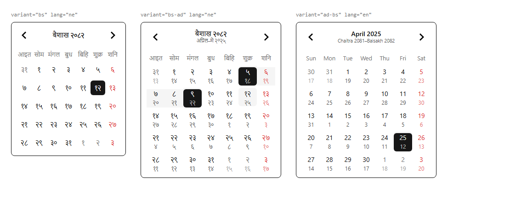

# Calendar for react-day-picker and shadcn/ui

`nepali-day-picker/react` turns [react-day-picker](https://daypicker.dev), and the
[shadcn/ui Calendar](https://ui.shadcn.com/docs/components/calendar) built on it, into a Bikram Sambat
calendar. Months, weeks, captions and dropdowns follow BS, and every value you get back is still a
plain JavaScript `Date`.



## Install

```sh
npm install nepali-day-picker react-day-picker
```

react-day-picker 9.7 or later, including 10, and React 18 or later. Both are optional peer
dependencies, so the core converter installs without them.

## With react-day-picker

Import `DayPicker` from `nepali-day-picker/react` instead of `react-day-picker`:

```tsx
"use client";
import { useState } from "react";
import { DayPicker } from "nepali-day-picker/react";
import { formatBs } from "nepali-day-picker";
import "react-day-picker/style.css";

export function DateOfBirth() {
  const [date, setDate] = useState<Date>();
  return (
    <>
      <DayPicker mode="single" selected={date} onSelect={setDate} variant="bs-ad" lang="ne" />
      <p>{date ? formatBs(date, "full") : "मिति छान्नुहोस्"}</p>
    </>
  );
}
```

All of react-day-picker's props work as usual: `mode="single" | "multiple" | "range"`, `disabled`,
`captionLayout="dropdown"`, `numberOfMonths`, `showOutsideDays`, `footer` and the rest.
`nepali-day-picker/react` also re-exports everything else from react-day-picker, so it can replace
it in any import.

## Variants

| `variant`        | Grid      | Each day shows            | Caption                                         |
| ---------------- | --------- | ------------------------- | ----------------------------------------------- |
| `"bs"` (default) | BS months | BS day                    | बैशाख २०८२                                       |
| `"bs-ad"`        | BS months | BS day, AD day underneath | बैशाख २०८२ with अप्रिल–मे २०२५ below               |
| `"ad-bs"`        | AD months | AD day, BS day underneath | April 2025 with Chaitra 2081–Baisakh 2082 below |
| `"ad"`           | AD months | AD day                    | April 2025 (अप्रिल २०२५ with `lang="ne"`)        |

## Props

These are added to react-day-picker's props.

| Prop            | Values                               | Default       | Effect                                                                |
| --------------- | ------------------------------------ | ------------- | --------------------------------------------------------------------- |
| `variant`       | `"bs"`, `"bs-ad"`, `"ad-bs"`, `"ad"` | `"bs"`        | See [Variants](#variants)                                             |
| `lang`          | `"ne"`, `"en"`                       | `"ne"`        | Script for the main calendar's names, digits and screen-reader labels |
| `secondaryLang` | `"ne"`, `"en"`                       | `lang`        | Script for the other calendar's dates in the dual variants            |
| `digits`        | `"ne"`, `"en"`                       | `lang`        | Digits only, for example Nepali names with ASCII digits               |
| `monthNames`    | `"common"`, `"formal"`               | `"common"`    | बैशाख or वैशाख                                                          |
| `weekdayFormat` | `"dd"`, `"ddd"`, `"dddd"`            | `"ddd"`       | शु / शुक्र / शुक्रबार, or Fr / Fri / Friday                                |
| `captionFormat` | a [pattern](api.md#tokens)           | `"MMMM YYYY"` | The month caption, for example `"YYYY [साल] MMMM"`                    |
| `labelFormat`   | a pattern                            | `"full"`      | Each day's screen-reader label                                        |

### What it sets for you

- `weekStartsOn={0}`: weeks start on Sunday (आइतबार).
- `startMonth` and `endMonth`: navigation stays inside BS 1970–2100.
- A `saturday` modifier with the class `ndp-saturday`, for the weekly holiday. Style it with
  `.ndp-saturday { color: … }`, or pass `modifiersClassNames={{ saturday: "text-red-600" }}`.
- Captions, weekday names, dropdowns and screen-reader labels in the chosen script. In the dual
  variants, each day's label names both dates: "Friday, 12 Baisakh 2082 (Friday, 25 April 2025)".

Pass any of these props yourself to override them.

## With shadcn/ui

### Option 1: change one import (recommended)

In `components/ui/calendar.tsx`, import from `nepali-day-picker/react`, and delete shadcn's default
`formatMonthDropdown`, which prints AD month names:

```diff
 import {
   DayPicker,
   getDefaultClassNames,
   type DayButton,
-} from "react-day-picker"
+} from "nepali-day-picker/react"
 …
       formatters={{
-        formatMonthDropdown: (date) =>
-          date.toLocaleString("default", { month: "short" }),
         ...formatters,
       }}
```

The Calendar now takes the Nepali props, with full TypeScript types:

```tsx
<Calendar mode="single" selected={date} onSelect={setDate} />
<Calendar mode="single" selected={date} onSelect={setDate} variant="bs-ad" className="[--cell-size:--spacing(10)]" />
<Calendar mode="range" selected={range} onSelect={setRange} lang="en" captionLayout="dropdown" />
```

shadcn's `CalendarDayButton` already styles a child `<span>` small and faded, so the second date in
`"bs-ad"` and `"ad-bs"` matches your theme with no extra CSS. Those two variants read best with a
slightly larger cell, `className="[--cell-size:--spacing(10)]"`.

### Option 2: no file edits

Spread `useNepaliCalendar` into the stock Calendar. Pass shadcn's `CalendarDayButton` so the dual
variants wrap it rather than react-day-picker's plain button:

```tsx
import { useState } from "react";
import { Calendar, CalendarDayButton } from "@/components/ui/calendar";
import { useNepaliCalendar } from "nepali-day-picker/react";

export function NepaliCalendar() {
  const [date, setDate] = useState<Date>();
  const nepali = useNepaliCalendar({ variant: "bs-ad", lang: "ne", DayButton: CalendarDayButton });
  return <Calendar mode="single" selected={date} onSelect={setDate} {...nepali} />;
}
```

The hook returns `dateLib`, `formatters`, `labels`, `components`, `weekStartsOn`, `startMonth`,
`endMonth`, `modifiers` and `modifiersClassNames`. Its formatters replace shadcn's AD month dropdown
formatter, so nothing needs deleting.

### A date picker

shadcn's date-picker pattern works unchanged; format the button text with `formatBs`:

```tsx
import { useState } from "react";
import { formatBs } from "nepali-day-picker";
import { Calendar } from "@/components/ui/calendar";
import { Button } from "@/components/ui/button";
import { Popover, PopoverContent, PopoverTrigger } from "@/components/ui/popover";

export function BsDatePicker({ value, onChange }: { value?: Date; onChange: (date?: Date) => void }) {
  const [open, setOpen] = useState(false);
  return (
    <Popover open={open} onOpenChange={setOpen}>
      <PopoverTrigger asChild>
        <Button variant="outline">{value ? formatBs(value, "long") : "मिति छान्नुहोस्"}</Button>
      </PopoverTrigger>
      <PopoverContent className="w-auto p-0" align="start">
        <Calendar
          mode="single"
          selected={value}
          defaultMonth={value}
          captionLayout="dropdown"
          onSelect={(date) => {
            onChange(date);
            setOpen(false);
          }}
        />
      </PopoverContent>
    </Popover>
  );
}
```

## In forms

The selected value is a `Date`, so form libraries need nothing special. With React Hook Form:

```tsx
<Controller
  control={control}
  name="dateOfBirth"
  render={({ field }) => <Calendar mode="single" selected={field.value} onSelect={field.onChange} />}
/>;
```

Send date-only values to your server as `formatAd(date, "iso")` or `formatBs(date, "iso")`, not as a
`Date`. See [Store and send dates safely](guides.md#store-and-send-dates-safely).

## Next.js and Server Components

`nepali-day-picker/react` starts with `"use client"`, so you can import it from a Server Component
file and it runs on the client. The core (`nepali-day-picker`) is not a client module: `formatBs`,
`adToBs` and the rest also run in Server Components.

## Styling hooks

| Selector                   | What it is                                                                 |
| -------------------------- | -------------------------------------------------------------------------- |
| `.ndp-saturday`            | Saturday cells                                                             |
| `[data-secondary-date]`    | The other calendar's day number inside a day button (`"bs-ad"`, `"ad-bs"`) |
| `[data-secondary-caption]` | The other calendar's months under the caption (`"bs-ad"`, `"ad-bs"`)       |

With react-day-picker's own day button, the second date gets small inline styles (smaller and
faded). With your own button, such as shadcn's, it gets none, so your classes decide.

## Building blocks

For custom setups, the pieces behind `DayPicker` are exported too.

| Export                                                         | What it does                                                                                    |
| -------------------------------------------------------------- | ----------------------------------------------------------------------------------------------- |
| `createBsDateLib(options)`                                     | The BS overrides for react-day-picker's `dateLib` prop (also from `nepali-day-picker/date-lib`) |
| `getBsDateLib(options)`                                        | A react-day-picker `DateLib` instance with those overrides                                      |
| `useNepaliCalendar(options)` / `createNepaliCalendar(options)` | All the props above, as a hook or a plain function                                              |
| `withSecondaryDate(DayButton, { calendar, lang })`             | Wraps a day button to show the other calendar's day under the main one                          |
| `withSecondaryCaption(CaptionLabel)`                           | Wraps a caption label to put the other calendar's months on a second line                       |

```tsx
import { DayPicker } from "react-day-picker";
import { createBsDateLib } from "nepali-day-picker/date-lib";

const bs = createBsDateLib({ lang: "en" });
<DayPicker dateLib={bs} weekStartsOn={0} />; // BS months; captions and day labels in English
```

`createBsDateLib` also translates the date-fns patterns react-day-picker uses (`"LLLL y"`, `"PPPP"`,
`"cccccc"` …) into BS. A pattern it cannot translate prints the BS date in ISO form and logs a warning
once in development.

## Notes

- **`timeZone` prop:** works. "Today" follows the given time zone, and a selected day comes back as a
  plain local-midnight `Date` for that BS day.
- **Edges of the data:** days just before BS 1970 or after BS 2100 can appear as outside days in the
  first or last month. They show placeholder numbers, and navigation never goes past them.
- **`data-day`:** in the BS variants, react-day-picker's `data-day` attribute on each cell holds the
  BS date (`2082-01-12`). shadcn's `CalendarDayButton` adds its own `data-day` with the AD date.
- **Tested with** react-day-picker 9.7.0, 9.14.0 and 10.0.2, React 19, and shadcn's current
  `calendar.tsx`, both with the one-import swap and with `useNepaliCalendar`.
